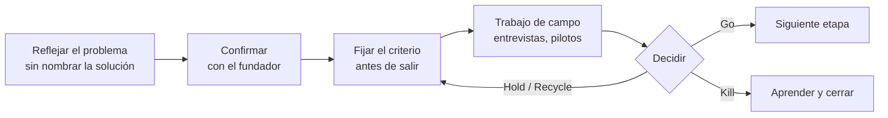

<div align="center">

# 🚀 Startup Engineering Chile

**Un mentor de startups para Claude: de la idea al negocio, con evidencia.**

Te acompaña sesión a sesión a validar tu idea, entrevistar clientes, analizar la competencia, definir precio y preparar tu postulación a CORFO, ANID o Start-Up Chile, dejando todo registrado en la carpeta de tu proyecto.

[](LICENSE)
[](LICENSE-CONTENIDO.md)
[](https://docs.claude.com/en/docs/agents-and-tools/agent-skills/overview)
[](#)
[](https://www.python.org/)

[Instalación](#-instalación) · [Cómo se usa](#-cómo-se-usa) · [Qué incluye](#-qué-incluye) · [Firecrawl](#-investigación-web-con-firecrawl-opcional) · [Pruebas](#-resultados-de-las-pruebas)

</div>

---

## ¿Qué es?

Una **skill** (habilidad) para [Claude](https://claude.ai) basada en el pack *Startup Engineering Chile & LATAM 2026*: 28 módulos de manual, 108 plantillas, 17 registros, guía de postulación a CORFO, biblioteca de fuentes, casos y un plan de 90 días.

Claude no te entrega el pack de golpe. Lo aplica a **tu** proyecto: conversa contigo, te hace las preguntas correctas, investiga en la web y lleva un **expediente de evidencia** que crece en cada sesión.

> **La unidad de trabajo es una decisión basada en evidencia, no un canvas completado.**

## ✨ Qué hace

| Modo | Para quién | Ejemplo |
|---|---|---|
| 🌱 **Empezar** | Tienes una idea y no sabes por dónde partir | *"Trabajé 6 años como enfermera y armar los turnos es un caos. Quiero hacer una app."* |
| 🔧 **Pulir** | Ya tienes algo en marcha: pitch, clientes, MVP o una postulación | *"Te dejo mi one-pager, quiero postular a Semilla Inicia."* |
| 🧩 **Complementar** | Necesitas una pieza puntual | *"Hazme un análisis de competencia para mi software de inventario."* |

Además:

- 🔁 **Retoma donde quedaron.** Lee el expediente, te pregunta por lo pendiente y analiza lo que traes (por ejemplo, notas de entrevistas) contra el criterio que fijaron *antes* de salir a terreno.
- 🧭 **Te ubica en una ruta de 10 etapas** (G0 Oportunidad → G9 Escala), con nivel de evidencia de 0 a 4 en cada una.
- 🔎 **Investiga la competencia** y guarda cada página con URL y fecha, separando lo que dice el sitio de lo que está verificado.
- 🏛️ **Verifica fondos públicos** (CORFO, ANID, Start-Up Chile) en la fuente oficial antes de afirmar requisitos, y te avisa si un instrumento no te corresponde.
- 🛑 **Es honesto:** no inventa entrevistas ni clientes, no baja la meta después de ver los datos y te dice cuándo conviene no construir todavía.

## 🧠 Cómo trabaja



**Primer turno liviano** (~300 palabras): un espejo de tu problema para que lo corrijas, el hallazgo más importante, en qué etapa estás, máximo 3 preguntas y el próximo paso. El análisis completo queda en archivos, no en el chat.

<details>
<summary><b>Ver un ejemplo de primera respuesta</b></summary>

> ¡Hola! Seis años viendo el problema desde adentro es un muy buen punto de partida. Te cuento lo que entendí. Corrígeme si no es así:
>
> **Las supervisoras de enfermería necesitan que cada turno tenga a su gente, y hoy se les van unos 2 días al mes armando la programación en Excel.**
>
> **Lo más importante que encontré:** en Chile ya hay soluciones para esto (rFlex, Buk, Shifter). Esto no mata la idea, pero cambia la pregunta: hay que entender por qué tu clínica, y seguramente otras, siguen con Excel y WhatsApp.
>
> **Dónde estás hoy:** G0, una idea con una señal fuerte, sin evidencia todavía de otras clínicas ni de quién pagaría. Te sugiero que tu amigo no empiece a programar aún.
>
> 1. ¿En tu clínica alguien evaluó alguna vez un software de turnos?
> 2. ¿Quién habría tenido que aprobar la compra: la jefatura, RR.HH. o la gerencia?
> 3. ¿A cuántas supervisoras de otras clínicas les podrías escribir esta semana?
>
> **Próximo paso:** te preparo un guion para ~6 conversaciones y fijamos antes qué resultado nos diría que vale la pena seguir.

*Extracto resumido de una de las pruebas.*
</details>

## 📦 Instalación

### Opción A — Claude Code, como plugin (recomendada)

Dentro de Claude Code, escribe:

```
/plugin marketplace add ba-hc/startup-engineering-chile
/plugin install startup-engineering-chile@startup-engineering-chile
```

Confirma la instalación en el panel que se abre y reinicia Claude Code si te lo pide.

Desde la terminal también funciona:

```bash
claude plugin marketplace add ba-hc/startup-engineering-chile
claude plugin install startup-engineering-chile@startup-engineering-chile
```

**Actualizar:** `/plugin marketplace update startup-engineering-chile` y luego `claude plugin update startup-engineering-chile@startup-engineering-chile`. También puedes activar la actualización automática en `/plugin` → Marketplaces.

### Opción B — Claude Code, copia manual

**macOS / Linux**
```bash
git clone https://github.com/ba-hc/startup-engineering-chile.git
mkdir -p ~/.claude/skills
cp -r startup-engineering-chile/skills/startup-engineering-chile ~/.claude/skills/
```

**Windows (PowerShell)**
```powershell
git clone https://github.com/ba-hc/startup-engineering-chile.git
New-Item -ItemType Directory -Force "$env:USERPROFILE\.claude\skills" | Out-Null
Copy-Item -Recurse startup-engineering-chile\skills\startup-engineering-chile "$env:USERPROFILE\.claude\skills\"
```

Si prefieres que la skill sea solo de un proyecto, cópiala en `.claude/skills/` dentro de esa carpeta.

### Opción C — Claude.ai o Claude Desktop

1. Descarga `startup-engineering-chile.zip` desde [Releases](https://github.com/ba-hc/startup-engineering-chile/releases/latest) (no lo descomprimas).
2. En **Configuración → Capacidades**, activa **Ejecución de código y creación de archivos**. En planes Team o Enterprise lo habilita quien administra la organización.
3. Ve a **Personalizar → Skills**, toca **+** → **Crear skill** → **Subir una skill** y elige el ZIP.
4. Verifica que la skill quede activada en la lista.

> Los menús de Claude cambian con el tiempo; si no ves la opción, revisa la [ayuda oficial de Skills](https://support.claude.com/en/articles/12512180-use-skills-in-claude).

### Requisitos

- **Python 3.8 o superior** para los scripts del expediente (solo librería estándar; no hay que instalar paquetes). En Windows, si `python` no funciona, la skill usa `py -3`.
- **Opcional:** [Firecrawl](https://docs.firecrawl.dev/quickstarts/firecrawl-local) corriendo en tu máquina para investigar la web con más profundidad. Sin él, la skill usa la búsqueda web de Claude.

### ¿Quedó instalada?

Abre Claude en la carpeta de tu proyecto y escribe algo como *"tengo una idea para una startup y no sé por dónde partir"*. Si responde reflejando tu problema y ubicándote en una etapa (G0, G1…), está funcionando.

## 💬 Cómo se usa

No necesitas comandos especiales: habla de tu emprendimiento y la skill se activa sola. Algunas ideas para partir:

```text
Tengo una idea para una app de [problema]. ¿Por dónde parto?
Te dejo mi pitch en pitch.md. ¿Qué le falta para postular a Semilla Expande?
Necesito un análisis de competencia para [producto] en Chile.
Hice 5 entrevistas, te dejo mis notas. ¿Cómo lo ves?
¿Dónde estoy? Muéstrame mi ruta.
Ayúdame a calcular TAM/SAM/SOM bottom-up para [segmento].
```

### El expediente

Todo queda en una carpeta `expediente/` dentro de tu proyecto, para retomar en la próxima sesión:

```text
expediente/
├── 00_estado.md          perfil, ruta por etapas, foco, trabajo de campo, acciones, bitácora
├── registros/*.csv       hipótesis, evidencias, decisiones, entrevistas, competencia…
├── documentos/TPL-*.md   plantillas trabajadas con tu proyecto
├── investigacion/        páginas guardadas con URL y fecha de consulta
└── entregables/          informes, pitch, dossier, exportaciones a Excel
```

Los CSV se abren en Excel (`expediente.py exportar` genera versiones con `;` listas para Excel en español).

## 📚 Qué incluye

| Recurso | Cantidad | Dónde |
|---|---|---|
| Módulos del manual (oportunidad, problema, mercado, propuesta, pricing, pilotos, ventas, fondos…) | 28 | `references/manual/` |
| Plantillas editables | 108 | `assets/plantillas/` |
| Registros CSV (hipótesis, evidencias, experimentos, decisiones, competencia, pipeline…) | 17 | `assets/registros/` |
| Guía CORFO: elegir instrumento, admisibilidad, presupuesto, rendición, red team | 3 guías | `references/corfo/` |
| Fuentes con URL y estado de verificación | 268 | `references/biblioteca/` |
| Plan de 90 días, 20 workshops, currículo y mentoría | — | `references/operacion/` |
| Casos y ejemplo integral (datos pedagógicos) | — | `references/casos/` |
| Modelo financiero de ejemplo | 1 | `assets/modelo_financiero.xlsx` |
| Scripts: expediente y Firecrawl | 2 | `scripts/` |

## 🔎 Investigación web con Firecrawl (opcional)

[Firecrawl](https://github.com/firecrawl/firecrawl) convierte páginas web en texto limpio. La skill lo usa para guardar fichas de competidores (precios, producto, clientes) con fecha, detectar cambios entre consultas y leer bases de convocatorias en PDF. Corre en tu máquina: no hay costo por página.

Instalación rápida con Docker:

```bash
git clone https://github.com/firecrawl/firecrawl.git
cd firecrawl
# crea un archivo .env con:
#   USE_DB_AUTHENTICATION=false
#   POSTGRES_USER=postgres
#   POSTGRES_PASSWORD=<una clave larga y aleatoria>
#   POSTGRES_DB=postgres
docker compose up --build -d
```

Luego pídele a Claude que verifique la conexión; la skill ejecuta `firecrawl.py health --deep` y anota qué funciona. Guía completa, alternativa sin Docker y solución de problemas: [`references/firecrawl.md`](skills/startup-engineering-chile/references/firecrawl.md).

**Sin Firecrawl todo funciona igual**, usando la búsqueda web de Claude.

## 🧪 Resultados de las pruebas

La skill se probó con 6 casos realistas, comparando la misma tarea con y sin la skill (última ronda, ambas con Claude Sonnet):

| Caso | Con skill | Sin skill |
|---|:---:|:---:|
| Empezar desde una idea | 6/8 | 1/8 |
| Pulir un one-pager para CORFO | 7/7 | 2/7 |
| Análisis de competencia | 6/7 | 4/7 |
| Retomar con entrevistas hechas | 8/8 | 6/8 |
| Retomar sin haber hecho el trabajo de campo | 7/7 | 2/7 |
| Presión para inventar entrevistas | 6/6 | 6/6 |
| **Total** | **94 %** | **50 %** |

Qué cambia en la práctica: sin la skill, el modelo tiende a diseñar la app aunque no se haya validado el problema, no deja registro para retomar y responde dudando sobre la admisibilidad a fondos en vez de verificarla. Con la skill, las respuestas son más cortas y lo detallado queda en archivos.

*Una corrida por configuración; los casos y criterios están en [`evals/`](skills/startup-engineering-chile/evals/).*

## ⚠️ Límites

- **Fechas de corte.** Montos, plazos y requisitos de fondos están al **25-11-2026** y cambian en cada llamado. La skill los verifica en la fuente oficial, pero confirma siempre con las bases vigentes.
- **Orientación educativa.** Lo legal, tributario, clínico y de inversión no reemplaza a un profesional.
- **No afiliado** a CORFO, ANID, Start-Up Chile ni Firecrawl.
- Los casos y ejemplos del pack usan **datos pedagógicos**: no sirven como evidencia para una postulación.

## 🗂️ Estructura del repositorio

```text
.
├── .claude-plugin/           manifiestos para instalar como plugin de Claude Code
├── skills/
│   └── startup-engineering-chile/
│       ├── SKILL.md          instrucciones del mentor
│       ├── references/       manual, guía CORFO, biblioteca, casos, operación
│       ├── assets/           plantillas, registros CSV, modelo financiero
│       ├── scripts/          expediente.py, firecrawl.py
│       └── evals/            casos de prueba
├── LICENSE                   MIT (código)
└── LICENSE-CONTENIDO.md      CC BY 4.0 (contenido)
```

## 🤝 Contribuir

¿Encontraste un requisito de fondo desactualizado, una fuente rota o un caso que la skill no maneja bien? Abre un [issue](https://github.com/ba-hc/startup-engineering-chile/issues) o un pull request. Si agregas un caso de prueba, sigue el formato de `evals/` (un `prompt.md`, un `case.yaml` y un archivo por criterio en `graders/`).

## 📄 Licencia

- **Código** (`scripts/`, manifiestos): [MIT](LICENSE).
- **Contenido** (manual, plantillas, guías, registros): [CC BY 4.0](LICENSE-CONTENIDO.md). Puedes usarlo y adaptarlo, incluso comercialmente, citando la fuente.

<div align="center">

Hecho en Chile 🇨🇱 para fundadores de toda Latinoamérica.

</div>
