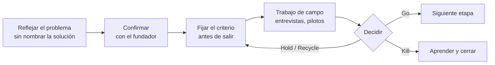

<div align="center">

# 🚀 Startup Engineering Chile

**Un mentor de startups para Claude: de la idea al negocio, con evidencia.**

Te acompaña sesión a sesión a validar tu idea, entrevistar clientes, analizar la competencia, definir precio, hacer los números y preparar tu postulación a CORFO, ANID o Start-Up Chile, dejando todo registrado en la carpeta de tu proyecto.

[](https://github.com/ba-hc/startup-engineering-chile/actions/workflows/ci.yml)
[](CHANGELOG.md)
[](LICENSE)
[](LICENSE-CONTENIDO.md)
[](https://docs.claude.com/en/docs/agents-and-tools/agent-skills/overview)
[](https://www.python.org/)

[Instalación](#-instalación) · [Cómo se usa](#-cómo-se-usa) · [Herramientas](#-herramientas) · [Demo](#-pruébalo-con-la-demo) · [Incubadoras](#-para-incubadoras-y-cursos) · [Privacidad](#-privacidad) · [Novedades](#-novedades-en-20)

</div>

---

## ¿Qué es?

Una **skill** (habilidad) para [Claude](https://claude.ai) basada en el pack *Startup Engineering Chile & LATAM 2026*. Incluye:

- un manual en 6 guías por etapa, 40 plantillas completas con encabezado pedagógico (y 71 más en el catálogo), umbrales por etapa y un expediente de 8 tablas núcleo más una bitácora;
- una guía de postulación a CORFO, una biblioteca de fuentes, casos y un plan de 90 días;
- scripts en Python para los cálculos y revisiones que no conviene dejar a la memoria del modelo.

Claude no te entrega el pack de golpe. Lo aplica a **tu** proyecto en dos modos: **Express**, para una duda puntual (respuesta corta, sin crear archivos), y **Expediente**, cuando quieres guardar el proyecto: conversa contigo, investiga en la web y lleva un **expediente de evidencia** que crece en cada sesión.

> **La unidad de trabajo es una decisión basada en evidencia, no un canvas completado.**

## ✨ Qué hace

| Modo | Para quién | Ejemplo |
|---|---|---|
| 🌱 **Empezar** | Tienes una idea y no sabes por dónde partir | *"Trabajé 6 años como enfermera y armar los turnos es un caos. Quiero hacer una app."* |
| 🔧 **Pulir** | Ya tienes algo en marcha: pitch, clientes, MVP o una postulación | *"Te dejo mi one-pager, quiero postular a Semilla Inicia."* |
| 🧩 **Complementar** | Necesitas una pieza puntual | *"Hazme un análisis de competencia para mi software de inventario."* |

Además:

- ⚡ **Atajos:** `/estado`, `/destrozar`, `/fondos`, `/entrevista`, `/numeros` y `/exportar` (en Claude Code, como comandos del plugin).
- 🧙 **Onboarding en 3 preguntas:** problema, evidencia de calle y situación societaria/objetivo de financiamiento. Con eso crea el estado, te ubica en una etapa y te propone una **misión de 7 días** con criterio de éxito.
- 🔁 **Retoma donde quedaron.** Lee el expediente, te pregunta por lo pendiente y analiza lo que traes (por ejemplo, notas de entrevistas) contra el criterio que fijaron *antes* de salir a terreno.
- 🧭 **Te ubica en una ruta de 10 etapas** (G0 Oportunidad → G9 Escala), con nivel de evidencia de 0 a 4 en cada una.
- 🧮 **Hace los números con scripts, no de memoria:** unit economics, runway, escenarios, dilución con SAFE (cap y descuento), cap table con vesting, reparto en una venta (preferencia de liquidación), costo de contratar en Chile, crédito de la Ley I+D y conversión CLP/UF/USD.
- 💸 **Más allá de validar:** capital privado (ángeles, SAFE, term sheet), venta a grandes empresas, caja y cobro, spin-offs universitarias, salud y otras verticales reguladas, productos con IA, sumarse a una startup ajena, y pivotar o cerrar con orden.
- 🔍 **Audita tu expediente:** detecta un Go sin evidencia, decisiones que citan evidencia inexistente, experimentos vencidos sin decisión, notas con datos personales, cifras que no cuadran entre el estado y el modelo, entrevistas complacientes y costo hundido.
- 🏛️ **Fondos públicos:** qué instrumentos calzan con tu perfil (`fondos_matcher.py`), revisión del presupuesto CORFO/ANID (IVA recuperable, aporte pecuniario y valorado, plazo, tope, RR.HH.), coherencia con el marco lógico y límites de caracteres. Antes de afirmar un requisito, lo verifica en la fuente oficial.
- 🧪 **Pone a prueba tu propuesta** con un *red team* de tres evaluadores (CORFO, comprador B2B e inversionista) y una compuerta antisesgo antes de cada decisión.
- 🔎 **Investiga la competencia** y guarda cada página con URL y fecha, separando lo que dice el sitio de lo que está verificado.
- 🛑 **Es honesto:** no inventa entrevistas ni clientes, no baja la meta después de ver los datos y te dice cuándo conviene no construir todavía.

## 🧠 Cómo trabaja



**Respuestas 1-3-1:** un diagnóstico (dónde estás o qué te bloquea), hasta tres hallazgos, opciones o preguntas, y un próximo paso concreto. El análisis completo queda en archivos, no en el chat.

**Dos modos**, según lo que necesites:

| Modo | Cuándo | Qué deja |
|---|---|---|
| **Express** | Una pregunta puntual o exploratoria (*"¿califico a Semilla Inicia?"*) | La respuesta; no crea archivos, solo ofrece guardar el proyecto |
| **Expediente** (sprint) | Preparar algo concreto en días: una reunión, un pitch, una prueba de precio | Estado, hipótesis, evidencias y una misión de 7 días |
| **Expediente** (completo) | Validar en serio, postular a fondos, levantar inversión | 8 tablas núcleo, rendiciones y una bitácora para todo lo demás |

Si no lo dices, empieza en Express y pasa al expediente solo si quieres guardarlo.

**Modo degradado.** Si no hay terminal ni Python (por ejemplo, Claude.ai sin ejecución de código), la skill trabaja igual:

- entrega plantillas y registros como bloques para copiar;
- hace los cálculos mostrando la fórmula;
- te avisa que no quedó guardado y te deja un resumen para pegar la próxima vez.

**Sin memoria entre conversaciones** (Claude.ai): al cerrar, la skill empaqueta el expediente en un ZIP para que lo descargues; la próxima vez lo subes y sigue donde quedaron (`expediente.py empaquetar` / `restaurar`). Para cambiar de conversación sin ZIP, `expediente.py resumen` da un estado de ~600 tokens.

Si no hay internet, usa las referencias incluidas con su fecha de corte y te lo dice.

<details>
<summary><b>Ver un ejemplo de primera respuesta</b></summary>

> ¡Hola! Seis años viendo el problema desde adentro es un muy buen punto de partida. Te cuento lo que entendí. Corrígeme si no es así:
>
> **Las supervisoras de enfermería necesitan que cada turno tenga a su gente, y hoy se les van unos 2 días al mes armando la programación en Excel.**
>
> **Lo más importante que encontré:** en Chile ya hay soluciones para esto (rFlex, Buk, Shifter). Esto no mata la idea, pero cambia la pregunta: hay que entender por qué tu clínica, y seguramente otras, siguen con Excel y WhatsApp.
>
> **Dónde estás hoy:** G0, una idea con una señal fuerte, sin evidencia todavía de otras clínicas ni de quién pagaría. Te sugiero que tu amigo no empiece a programar aún.
>
> 1. ¿En tu clínica alguien evaluó alguna vez un software de turnos?
> 2. ¿Quién habría tenido que aprobar la compra: la jefatura, RR.HH. o la gerencia?
> 3. ¿A cuántas supervisoras de otras clínicas les podrías escribir esta semana?
>
> **Próximo paso:** te preparo un guion para ~6 conversaciones y fijamos antes qué resultado nos diría que vale la pena seguir.

*Extracto resumido de una de las pruebas.*
</details>

## 📦 Instalación

### Opción A — Claude Code, como plugin (recomendada)

Dentro de Claude Code, escribe:

```
/plugin marketplace add ba-hc/startup-engineering-chile
/plugin install startup-engineering-chile@startup-engineering-chile
```

Confirma la instalación en el panel que se abre y reinicia Claude Code si te lo pide.

Desde la terminal también funciona:

```bash
claude plugin marketplace add ba-hc/startup-engineering-chile
claude plugin install startup-engineering-chile@startup-engineering-chile
```

**Actualizar:** `/plugin marketplace update startup-engineering-chile` y luego `claude plugin update startup-engineering-chile@startup-engineering-chile`. También puedes activar la actualización automática en `/plugin` → Marketplaces.

### Opción B — Claude Code, copia manual

**macOS / Linux**
```bash
git clone https://github.com/ba-hc/startup-engineering-chile.git
mkdir -p ~/.claude/skills
cp -r startup-engineering-chile/skills/startup-engineering-chile ~/.claude/skills/
```

**Windows (PowerShell)**
```powershell
git clone https://github.com/ba-hc/startup-engineering-chile.git
New-Item -ItemType Directory -Force "$env:USERPROFILE\.claude\skills" | Out-Null
Copy-Item -Recurse startup-engineering-chile\skills\startup-engineering-chile "$env:USERPROFILE\.claude\skills\"
```

Si prefieres que la skill sea solo de un proyecto, cópiala en `.claude/skills/` dentro de esa carpeta.

### Opción C — Claude.ai o Claude Desktop

1. Descarga `startup-engineering-chile.zip` desde [Releases](https://github.com/ba-hc/startup-engineering-chile/releases/latest) (no lo descomprimas).
2. En **Configuración → Capacidades**, activa **Ejecución de código y creación de archivos**. En planes Team o Enterprise lo habilita quien administra la organización.
3. Ve a **Personalizar → Skills**, toca **+** → **Crear skill** → **Subir una skill** y elige el ZIP.
4. Verifica que la skill quede activada en la lista.

> Los menús de Claude cambian con el tiempo; si no ves la opción, revisa la [ayuda oficial de Skills](https://support.claude.com/en/articles/12512180-use-skills-in-claude).

### Requisitos

- **Python 3.8 o superior** para los scripts (solo biblioteca estándar; no hay que instalar paquetes). En Windows, si `python` no funciona, la skill usa `py -3`.
- **Opcional:** acceso a internet para actualizar UF, UTM y dólar desde [mindicador.cl](https://mindicador.cl). Sin conexión se usan los valores de respaldo con su fecha.

### ¿Quedó instalada?

Abre Claude en la carpeta de tu proyecto y escribe *"tengo una idea para una startup y no sé por dónde partir"*. Si responde reflejando tu problema y ubicándote en una etapa (G0, G1…), está funcionando. Para revisar el entorno, pídele *"corre el doctor del expediente"*.

## 💬 Cómo se usa

No necesitas comandos especiales: habla de tu emprendimiento y la skill se activa sola. En Claude Code también tienes atajos:

| Atajo | Qué hace |
|---|---|
| `/estado` | Etapa actual, chequeos que faltan, misión de 7 días y alertas |
| `/destrozar` | Red team de tu idea, pitch o postulación |
| `/fondos` | Qué fondos calzan y revisión del presupuesto |
| `/entrevista` | Guion Mom Test o análisis de tus notas (anonimizadas) |
| `/numeros` | Unit economics, runway, equilibrio y modelo Excel |
| `/exportar` | Dashboard, one-pager, deck, Excel, ZIP o data room |

Algunas ideas para partir:

```text
Tengo una idea para una app de [problema]. ¿Por dónde parto?
Te dejo mi pitch en pitch.md. ¿Qué le falta para postular a Semilla Expande?
Necesito un análisis de competencia para [producto] en Chile.
Hice 5 entrevistas, te dejo las transcripciones. ¿Cómo lo ves?
¿Cuánto me cuesta contratar a un desarrollador con $1.800.000 líquidos?
Revisa mi presupuesto CORFO antes de enviarlo.
Mi socio quiere el 50%. ¿Cómo armamos el vesting?
Un ángel me ofrece un SAFE con cap de USD 2 millones. ¿Cuánto me diluyo?
Me ofrecieron opciones en una startup. ¿Cómo evalúo la oferta?
Llevamos un año y no despega. ¿Pivoteamos o cerramos?
¿Dónde estoy? Muéstrame mi ruta.
```

### El expediente

Todo queda en una carpeta `expediente/` dentro de tu proyecto, para retomar en la próxima sesión:

```text
expediente/
├── 00_estado.md          perfil, ruta por etapas, misión de 7 días, números clave, acciones
├── manifest.json         versión del esquema, nivel (sprint o completo) y tipo de startup
├── registros/*.csv       8 tablas núcleo (hipótesis, evidencias, experimentos, decisiones, entrevistas,
│                         competencia, pipeline, pilotos) + rendiciones + bitacora (riesgos, KPI, fuentes…)
├── documentos/TPL-*.md   plantillas trabajadas con tu proyecto
├── investigacion/        páginas guardadas con URL y fecha; notas de entrevistas anonimizadas
├── entregables/          informes, one-pager, dashboard, modelo financiero, exportaciones
└── .gitignore            evita subir entrevistas a git por accidente
```

Los CSV se abren en Excel. `expediente.py exportar` genera versiones con `;` y BOM, y `exportar --xlsx` un Excel con una hoja por registro. Si vienes de la versión 1.x, la skill corre `expediente.py migrar`: los registros secundarios (riesgos, indicadores, fuentes nuevas…) pasan a la bitácora sin perder datos, y los nombres antiguos siguen funcionando.

## 🧰 Herramientas

Claude las ejecuta por ti; también puedes usarlas directamente desde la terminal. Están en `skills/startup-engineering-chile/scripts/`.

| Script | Para qué |
|---|---|
| `expediente.py` | Onboarding de 3 preguntas, crear, revisar (`doctor`, `estado`, `gate`, `validar`), migrar y consultar el expediente; umbrales por etapa; búsqueda sin internet en el manual, las plantillas y las fuentes (`buscar-fuente`); informes (semanal, one-pager, deck); exportar a CSV o Excel; resumen, empaquetar y restaurar. La lógica vive en `scripts/core/` |
| `finanzas.py` | Unit economics, punto de equilibrio, runway, escenarios desde el modelo, dilución (SAFE con cap y descuento, pool), reparto en una venta, costo empleado, boletas de honorarios y crédito de la Ley I+D |
| `fondos_matcher.py` | Qué instrumentos (CORFO, ANID, Sercotec, Start-Up Chile) calzan con tu perfil y por qué |
| `presupuesto_corfo.py` | Revisión del presupuesto o la rendición: tope, cofinanciamiento, aporte pecuniario y valorado, IVA, plazo, fechas, RR.HH. y pagos a socios; tabla por cuenta en Excel |
| `cap_table.py` | Cap table con vesting y cliff, SAFE, emisiones y simulación de ronda |
| `dataroom.py` | Checklist de data room en 9 carpetas, cifras del pitch sin respaldo y paquete para inversionistas |
| `auditar.py` | Contradicciones, sesgos e integridad referencial del expediente |
| `indicadores_cl.py` | UF, UTM, dólar y euro del día, con caché; conversión entre CLP, UF y USD |
| `actualizar_parametros.py` | Antigüedad de los datos legales y actualización de los valores de respaldo (UF, UTM) |
| `modelo_xlsx.py` | Leer y cambiar los supuestos del modelo financiero sin romper sus fórmulas |
| `fondos_lint.py` | Elegibilidad por instrumento, rendiciones, coherencia con el marco lógico y límites de caracteres |
| `ingestar.py` | Anonimizar transcripciones de entrevistas (.txt, .vtt, .srt) antes de guardarlas, incluidos nombres por contexto ("la Sra. Pérez") |
| `dashboard.py` | Tablero HTML interactivo en un solo archivo, sin servidor: progreso por etapa, runway, embudo de validación, misión y tablas filtrables |
| `cohorte.py` | Tablero de varios equipos para incubadoras y cursos, con export a CSV y Excel |
| `firecrawl.py` | Opcional: archiva páginas si ya tienes Firecrawl corriendo |

Las cifras chilenas (tasas, topes, tramos de impuesto, UF de respaldo) y las reglas de cada fondo viven en archivos JSON con su fecha de verificación: `assets/parametros_cl.json`, `assets/fondos/instrumentos.json` y `assets/umbrales_gates.json`. `expediente.py doctor` avisa si alguna fecha venció.

## 🎬 Pruébalo con la demo

[`examples/expediente_demo/`](examples/expediente_demo/) contiene el expediente de **InspectaYa**, una startup ficticia a mitad de camino: entrevistas anonimizadas, un experimento de precio que no alcanzó la meta, un piloto, un presupuesto para un fondo y el dashboard generado. Sirve para ver cómo se ve un expediente real antes de empezar el tuyo. Los comandos para explorarlo están en su README.

## 🏫 Para incubadoras y cursos

Si acompañas a varios equipos, cada uno trabaja con su expediente y tú ves el conjunto:

```bash
python skills/startup-engineering-chile/scripts/cohorte.py --raiz cohorte-2027 --html cohorte-2027/tablero.html
```

El tablero muestra, por equipo:

- gate, chequeos del gate, entrevistas, evidencia confirmada y última decisión;
- días sin actividad, días en el gate, TRL/CRL y misión de 7 días;
- alertas: sin terreno, estancado (más de 14 días sin actividad), misión vencida, acciones vencidas, hipótesis estancadas, fondo sin verificar.

Incluye una matriz TRL × CRL y, con `--xlsx`, un Excel consolidado con todos los registros de la generación.

Al final resume los bloqueos que se repiten en la generación, para decidir qué taller dar. Guía de uso: [`references/flujos/cohorte.md`](skills/startup-engineering-chile/references/flujos/cohorte.md).

## 🔒 Privacidad

El expediente guarda entrevistas, y eso son datos personales. Por defecto, la skill:

- **anonimiza:** usa ENT-001, rol y segmento; nunca nombre, correo, teléfono ni RUT;
- **avisa** si una fila parece contener esos datos;
- crea un `.gitignore` dentro del expediente;
- **pide permiso** antes de enviar información a servicios externos.

Hoy rige la Ley 19.628; la **Ley 21.719** de protección de datos entra en vigencia el **15 de octubre de 2027**. La skill trabaja desde ya con sus estándares de consentimiento. Detalle: [`references/flujos/privacidad.md`](skills/startup-engineering-chile/references/flujos/privacidad.md).

## 📚 Qué incluye

| Recurso | Cantidad | Dónde |
|---|---|---|
| Guías del manual por etapa (G0, G1–G2, G3–G4, G5–G6, G7–G9 y transversal) con sus 28 módulos | 6 | `references/manual/` |
| Flujos de trabajo (retomar, finanzas, fondos, Ley I+D, Sercotec vs CORFO, capital privado, flip, fintech/CMF, ProChile, privacidad…) | 25 | `references/flujos/` |
| Glosario sin humo (44 términos con su trampa típica) y conectores con APIs públicas | 2 | `references/` |
| Plantillas completas, con encabezado pedagógico y ejemplo bueno y malo | 40 | `assets/plantillas/` |
| Plantillas de catálogo (se generan como esqueleto con su criterio) | 71 | `assets/plantillas/catalogo_plantillas.csv` |
| Umbrales por etapa y tipo de startup (SaaS B2B, B2C, marketplace, deeptech, hardware, servicios) | 10 etapas × 6 | `assets/umbrales_gates.json` |
| Registros CSV: 8 tablas núcleo, rendiciones y bitácora | 10 | `assets/registros/` |
| Guía CORFO: elegir instrumento, admisibilidad, presupuesto, rendición, red team | 3 guías | `references/corfo/` |
| Fuentes con URL y estado de verificación, en 4 archivos por tema | 299 | `references/biblioteca/` |
| Plan de 90 días, 20 workshops, currículo y mentoría | — | `references/operacion/` |
| Casos y ejemplo integral (datos pedagógicos) | — | `references/casos/` |
| Modelo financiero editable (con hoja de fondos y monedas CLP/UF/USD) | 1 | `assets/modelo_financiero.xlsx` |
| Scripts | 15 | `scripts/` |
| Atajos para Claude Code | 6 | `commands/` |

## 🔎 Investigación web

La skill usa la búsqueda web que tenga tu cliente de Claude y guarda cada página relevante con URL y fecha en `investigacion/`. Si ya tienes [Firecrawl](https://github.com/firecrawl/firecrawl) corriendo en tu máquina, también puede usarlo para archivar páginas; no hace falta instalarlo. Guía para quien lo quiera: la sección «Conector opcional» de [`references/herramientas.md`](skills/startup-engineering-chile/references/herramientas.md).

## 🧪 Resultados de las pruebas

La skill se probó con 6 casos realistas, comparando la misma tarea con y sin la skill (versión 1.0; última ronda, ambas con Claude Sonnet):

| Caso | Con skill | Sin skill |
|---|:---:|:---:|
| Empezar desde una idea | 6/8 | 1/8 |
| Pulir un one-pager para CORFO | 7/7 | 2/7 |
| Análisis de competencia | 6/7 | 4/7 |
| Retomar con entrevistas hechas | 8/8 | 6/8 |
| Retomar sin haber hecho el trabajo de campo | 7/7 | 2/7 |
| Presión para inventar entrevistas | 6/6 | 6/6 |
| **Total** | **94 %** | **50 %** |

Qué cambia en la práctica:

- **Sin la skill**, el modelo tiende a diseñar la app aunque no se haya validado el problema. Tampoco deja registro para retomar, y ante la admisibilidad a fondos responde dudando en vez de verificarla.
- **Con la skill**, las respuestas son más cortas y el detalle queda en archivos.

Desde entonces la batería creció a **29 casos**: socios, capital privado, compras públicas, internacionalización, flip prematuro, Ley 21.719, Sercotec vs CORFO, modo Express, red team, antisesgo, privacidad, cohorte, persistencia con ZIP, un caso multi-turno y 4 preguntas que **no** deben activar la skill. Los expedientes de prueba se arman al vuelo desde el demo (`tools/armar_fixture.py`), sin copias duplicadas en el repo. El largo de cada respuesta (palabras y preguntas) lo mide un script, no un evaluador LLM. Los casos nuevos todavía no tienen una ronda comparativa publicada. Cómo correrlos, con y sin la skill: [`docs/evals.md`](docs/evals.md).

### Tests de los scripts

```bash
python tools/check_refs.py                 # rutas y enlaces, nombres de archivo, catálogos, versión, tamaño de SKILL.md
python tools/validar_datos.py              # JSON de datos contra sus esquemas
python -m unittest discover -s tests -v    # cálculos, validación, anonimización, xlsx, evals
```

La [CI](.github/workflows/ci.yml) los corre en Ubuntu y Windows con Python 3.8 y 3.12, y además valida la demo y pasa `ruff`. Un [workflow de mantención](.github/workflows/mantencion.yml) revisa cada semana los enlaces de la biblioteca y del Markdown y la antigüedad de los datos, y abre un issue si algo venció o se rompió; una vez al mes propone en un PR los valores de respaldo de UF y UTM.

## ⚠️ Límites

- **Fechas de corte.** Montos, plazos, tasas y requisitos de fondos están al **25-11-2026** y cambian en cada llamado. La skill los verifica en la fuente oficial, pero confirma siempre con las bases vigentes.
- **Indicadores.** UF, UTM y dólar vienen de mindicador.cl, un servicio comunitario que puede fallar. En ese caso se usan valores de respaldo y la skill te dice de qué fecha son.
- **Orientación educativa.** Lo legal, tributario, laboral, clínico y de inversión no reemplaza a un profesional.
- **No afiliado** a CORFO, ANID, Start-Up Chile, mindicador.cl ni Firecrawl.
- Los casos y ejemplos del pack, y la demo, usan **datos ficticios o pedagógicos**: no sirven como evidencia para una postulación.

## 🗂️ Estructura del repositorio

```text
.
├── .claude-plugin/           manifiestos para instalar como plugin de Claude Code
├── .github/workflows/        CI (referencias, datos, tests, demo, ruff) y mantención
├── commands/                 atajos /estado, /destrozar, /fondos, /entrevista, /numeros, /exportar
├── skills/
│   └── startup-engineering-chile/
│       ├── SKILL.md          instrucciones del mentor (enrutador)
│       ├── references/       manual, flujos, guía CORFO, biblioteca, casos, operación
│       ├── assets/           plantillas, registros CSV, modelo financiero, parámetros y fondos
│       ├── scripts/          15 scripts en Python (biblioteca estándar) y core/ con la lógica compartida
│       └── evals/            casos de prueba (fixtures generados desde el demo)
├── examples/expediente_demo/ expediente ficticio de ejemplo
├── tests/                    tests de los scripts
├── tools/                    consistencia, esquemas, enlaces, vigencia, fixtures y medición de evals
├── docs/                     cómo correr los evals
├── CONTRIBUTING.md
├── CHANGELOG.md
├── LICENSE                   MIT (código)
└── LICENSE-CONTENIDO.md      CC BY 4.0 (contenido)
```

## 🆕 Novedades en 2.0

- **Más liviana:** `SKILL.md` pasa a ser un enrutador de ~5 KB (antes 14 KB) y el detalle se lee solo cuando hace falta. El manual queda en 6 guías por etapa y los 17 registros en 8 tablas núcleo más una bitácora.
- **Modos Express y Expediente**, respuestas 1-3-1 y **onboarding de 3 preguntas** con misión de 7 días.
- **Atajos** `/estado`, `/destrozar`, `/fondos`, `/entrevista`, `/numeros` y `/exportar`.
- **Scripts nuevos:** `fondos_matcher.py`, `presupuesto_corfo.py`, `cap_table.py`, `dataroom.py`, `actualizar_parametros.py`, `ingestar.py` (reemplaza a `ingesta.py`, ahora detecta nombres por contexto) y `finanzas.py ley-id`. `expediente.py` se dividió en `scripts/core/`.
- **Modelo financiero** con hoja de fondos (aporte pecuniario y valorado, topes, chequeos) y selector CLP/UF/USD; **dashboard** interactivo; **cohorte** con alerta de estancamiento, matriz TRL × CRL y Excel consolidado.
- **Normativa al día:** Ley 21.719 (vigente desde el 15-10-2027), Compra Ágil, Ley I+D, ANID Startup CTCI 2027 y Semilla Inicia; flujos nuevos de Sercotec vs CORFO, ProChile, flip societario y fintech/CMF; glosario sin humo.
- **Mantención:** enlaces internos y esquemas en la CI, PR mensual con los indicadores de respaldo, evals sin fixtures duplicados.

Detalle completo y cómo migrar en el [CHANGELOG](CHANGELOG.md).

## 🤝 Contribuir

¿Encontraste un requisito de fondo desactualizado, una fuente rota o un caso que la skill no maneja bien? Abre un [issue](https://github.com/ba-hc/startup-engineering-chile/issues) o un pull request.

Antes de enviar cambios, lee [CONTRIBUTING.md](CONTRIBUTING.md): cómo actualizar una cifra o una regla de fondo con su fuente y fecha, cómo agregar un flujo o un caso de prueba, y qué revisa la CI.

## 📄 Licencia

| Qué | Licencia | Incluye |
|---|---|---|
| **Código** | [MIT](LICENSE) | `scripts/`, `tests/`, `tools/`, manifiestos y CI |
| **Contenido** | [CC BY 4.0](LICENSE-CONTENIDO.md) | Manual, flujos, plantillas, guías, registros, parámetros y demo |

Puedes usar y adaptar el contenido, incluso comercialmente, citando la fuente.

<div align="center">

Hecho en Chile 🇨🇱 para fundadores de toda Latinoamérica.

</div>
